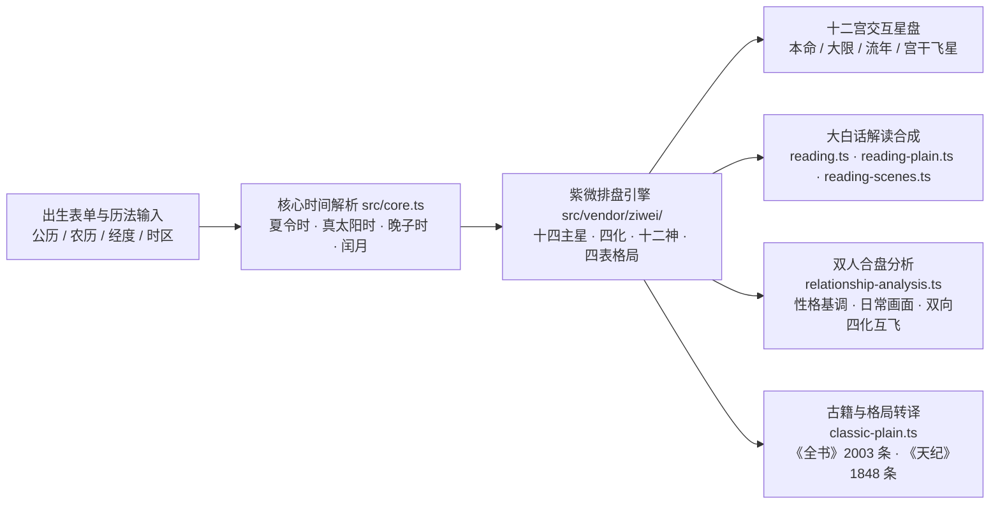

<div align="center">

# 紫微研习室 · Ziwei Study Lab

**纯浏览器本地运行 · 严肃历法口径 · 全程大白话解读 · 双人合盘与古籍解码工作台**

[](https://github.com/ChenneyZhuang/ziwei-study-lab/actions/workflows/ci.yml)
[](LICENSE)
[](public/data/TIANJI-LICENSE.md)
[](https://react.dev/)
[](https://www.typescriptlang.org/)
[](https://vite.dev/)

<p>
  <a href="#为什么做这个工作台">核心亮点</a> ·
  <a href="#九大功能页面全景">功能全景</a> ·
  <a href="#系统架构与处理流程">架构流程</a> ·
  <a href="#快速开始与常用脚本">本地运行</a> ·
  <a href="#严谨度验证与口径对拍">测试对拍</a> ·
  <a href="#纯静态部署指南">静态部署</a> ·
  <a href="#开源协议与语料声明">协议声明</a>
</p>

</div>

---

## 为什么做这个工作台

市面上不少排盘工具要么 **只丢出一堆生涩术语**（例如「巨门化忌冲迁移」「铃昌陀武」），新手看半天还是一头雾水；要么把出生资料上传到远端黑盒服务器，通过 AI 凭空编造无法核对的模板话术。

**紫微研习室** 希望提供另一种完全透明的研习体验：

- **全程零后端、纯本机运算**：不设账号体系、无统计追踪、不调用任何 AI 接口；你的生日、出生地与已保存命盘只保留在当前浏览器的 `localStorage` 中，可随时一键导出 JSON 备份。
- **每一句大白话都可追溯到星曜与规则**：不靠大模型“自由发挥”，而是通过 168 组「主星 × 宫位」核心表达库、三方四正联动规则、十二神与四化合成引擎，输出直接落到生活细节里的平实人话。
- **温和理性、去恐吓化**：将古书里的极端口诀（如“孤寡”“横夭”“贫贱”等传统修辞）转译为可理解的行为倾向与现实提醒，辅助自我觉察而非制造焦虑。
- **严谨的多派别历法口径**：底层排盘引擎改写自开源项目 [`Renhuai123/ziwei-doushu`](https://github.com/Renhuai123/ziwei-doushu)（MIT），完整支持农历闰月政策、1930–1995 年历史夏令时核校、真太阳时与晚子时换日开关，并与 `iztro` 进行千级样本自动化对拍。

---

## 与上游项目的协同与增强

| 维度 | 上游开源引擎 (`Renhuai123/ziwei-doushu`) | 本项目（紫微研习室） |
| --- | --- | --- |
| **运行形态** | 服务端/全栈架构与研究工具 | **纯前端 SPA**（Vite + React 19），无需后端或环境变量即可启动 |
| **小白可读性** | 侧重星盘准确性与专业术语研究 | **十三维大白话解读** + 每主题 3 个日常具体画面 + 古诀逐条直译 |
| **双人合盘** | 基础合盘对比参考 | **一键载入本机已存命盘 / 名人案例**、**A ⇄ B 视角互换**、双向生年四化互飞、三大日常相处画面 |
| **典籍与格局** | 收录《全书》片段与四表格局识别 | 为《全书》《天纪》检索结果与全部格局自动附带 **白话导读与术语胶囊** |
| **本地数据管理** | 无独立前端档案管理 | 支持多命盘收藏、JSON 备份导出与安全格式校验导入，支持打印 / 导出 PDF |

---

## 九大功能页面全景

| 入口 | 模块名称 | 核心功能说明 |
| --- | --- | --- |
| 🏠 | **工作台** | 展示本机已保存的命盘、快速入口卡片及 11 位公开历史/现代名人参考命盘 |
| 🧭 `01` | **我的命盘** | 公历/农历（含闰月）录入、真太阳时与时区校正、交互式十二宫星盘、本命/大限/小限/流年/流月/流日/流时/宫干飞星同屏切换，与 **13 维大白话解读 + PDF 打印** |
| 💬 `02` | **问盘助手** | 纯本地关键词与宫位/四化/空宫规则匹配助手：直接回答常见困惑并给出典籍对照线索 |
| ⚖️ `03` | **口径对照** | 横向对比 **不确定时辰候选区间、晚子时（当日 vs 次日）、闰月规则、四套亮度表（全书 / 中州 / 现代修订 1 & 2）** 对盘面的影响 |
| 💞 `04` | **双人合盘** | 直接从已保存命盘或手动输入选取 A / B 两张命盘，提供相处总基调、三大日常画面（沟通吵架 / 花钱分工 / 共事合作）、理想型互查、双向四化互飞、大限节奏同步与古诀直译 |
| 📚 `05` | **资料与典籍** | 离线检索《紫微斗数全书》维基文库片段（**2,003** 条）与《天纪》学习摘录（**1,848** 条），每条附带白话拆解 |
| 🔎 `06` | **相似命盘样本** | 按指定年份逐日筛选同构命宫、主星与四化组合的历史日期样本 |
| ⏱️ `07` | **小六壬** | 依据农历月、日、时三步顺推传统六宫（大安 / 留连 / 速喜 / 赤口 / 小吉 / 空亡），附古口诀与白话解释 |
| 📊 `08` | **数据实验室** | 本地批量采样统计命宫主星分布，并支持纯本地流式检索上游开源 v4.0 `.jsonl` 数据集 |

---

## 系统架构与处理流程



---

## 快速开始与常用脚本

### 环境要求

- **Node.js**：推荐 **v20+**（CI 使用 Node.js 22）
- **Python 3**（可选）：仅当你想重新用 BeautifulSoup 抓取/整理本地维基文库 HTML 页面时使用

### 安装与启动

```bash
# 1. 克隆仓库
git clone https://github.com/ChenneyZhuang/ziwei-study-lab.git
cd ziwei-study-lab

# 2. 安装依赖
npm install

# 3. 启动本地开发服务器（默认监听 127.0.0.1:5173）
npm run dev
```

### 常用命令一览

| 命令 | 说明 |
| --- | --- |
| `npm run dev` | 启动 Vite 本地开发服务器（`127.0.0.1`） |
| `npm run build` | 执行 TypeScript 类型检查（`tsc --noEmit`）并构建生产产物到 `dist/` |
| `npm run preview` | 本地预览 `dist/` 生产构建结果 |
| `npm run typecheck` | 仅执行 `tsc --noEmit` 静态类型检查 |
| `npm test` | 运行核心引擎、历法边界、白话/合盘与 UI 渲染测试（`tests/core.test.ts` + `tests/ui.test.tsx`） |
| `npm run test:upstream` | 运行 7 套上游算法与历法回归测试 |
| `npm run audit` | 运行全量样本对拍校验与解读一致性审计 |
| `npm run check` | 一键串联运行 `typecheck` → `test` → `test:upstream` → `audit` → `build` |

---

## 严谨度验证与口径对拍

本项目已接入 GitHub Actions 自动化检查（[`.github/workflows/ci.yml`](.github/workflows/ci.yml)），每次推送均会完整跑通以下验证：

- **上游算法回归（`npm run test:upstream`）**：
  - `dst-cn`：1930–1995 年中国历史夏令时逐日比对 **24,106 天**（含 5,802 个夏令时命中日）及 1988/1992 分歧边界；
  - `clock-adjust`：历史半小时时区、夏令时减时与跨日回退/前进边界；
  - `sizhu-lichun-boundary`：节气立春前后的年柱/月柱切换校验（10 项断言）；
  - `pan-integrity`：**768 个采样命盘 × 7 条紫微安星铁律**（含紫府对称、机梁同宫等）；
  - `hongluan-tianxi`、`natal-dual-sihua-same-palace`、`solar-date-exists` 专项回归。
- **多样本交叉对拍（`npm run audit`）**：
  - **2,112 组本命样本** 与 `iztro` 逐项比对命宫、身宫、五行局、十二宫位、主星与本命四化，失配率 **`0.0%`**；
  - **400 组流年 / 大限探针** 与 `iztro` 比对大限宫位、年龄区间、大限四化与流年四化，失配 **`0` 项**；
  - **1,092 条主题解读一致性检查**：`problems: 0`；
  - 边界压力审计：模糊分钟切分、农历/公历越界与流月/流日边界。

---

## 纯静态部署指南

构建产物 `dist/` 为 100% 静态资源，可以直接部署到任意静态网站托管服务：

- **推荐平台**：[Vercel](https://vercel.com/)、[Netlify](https://www.netlify.com/)、[Cloudflare Pages](https://pages.cloudflare.com/) 或 Nginx / Caddy 等自有服务器
- **构建配置**：
  - **Build command**: `npm run build`
  - **Output directory**: `dist`
- **路径提示**：应用内会通过根相对路径加载 `/data/quanshu-wikisource.json`、`/data/tianji.json` 和 `/UPSTREAM-LICENSE.txt`，因此请部署在**域名或子域名的根路径 `/` 下**（例如 `https://your-site.vercel.app/`）。

---

## 目录结构

```text
ziwei-study-lab/
├── .github/workflows/ci.yml       # GitHub Actions 自动类型检查、测试、对拍与构建
├── public/
│   ├── data/
│   │   ├── quanshu-wikisource.json # 《紫微斗数全书》维基文库检索语料（2,003 条）
│   │   ├── tianji.json             # 《天纪》学习摘录语料（1,848 条，CC BY-NC-SA 4.0）
│   │   └── TIANJI-LICENSE.md       # 《天纪》语料非商用单独许可声明
│   ├── UPSTREAM-LICENSE.txt        # 供前端页脚静态链接使用的上游 MIT 许可副本
│   └── favicon.svg
├── scripts/
│   └── extract-wikisource.py       # 从本地维基文库 HTML 重建 quanshu-wikisource.json 的工具脚本
├── src/
│   ├── App.tsx                     # 应用路由骨架、工作台首页、排盘主页面与本机存档导入导出
│   ├── components.tsx              # 十二宫交互星盘、宫位详情卡、出生资料与经度城市表单
│   ├── core.ts                     # 统一排盘门面、真太阳时校正、候选时段切分与农历换算
│   ├── reading.ts                  # 十三维主题结构化拼装与命格总览引擎
│   ├── reading-plain.ts            # 168 组「主星 × 宫位」纯大白话核心表达库
│   ├── reading-scenes.ts           # 日常三大具体画面、辅煞神明与三方联动白话合成器
│   ├── reading-knowledge.ts        # 主星 / 双星 / 四化 / 辅煞结构知识字典
│   ├── classic-plain.ts            # 四表格局古注、夫妻诀、《全书》与《天纪》白话解码器
│   ├── relationship-analysis.ts    # 双人合盘基调、日常场景与双向四化互飞引擎
│   ├── compare.ts / similar.ts / dataset.ts / liuren.ts / storage.ts
│   ├── style.css                   # 响应式与亮/暗双主题样式表
│   ├── pages/                      # 8 个独立功能页面（解读、合盘、问盘、典籍、对照、样本、小六壬、实验室）
│   └── vendor/ziwei/               # 改编自 Renhuai123/ziwei-doushu 的纯浏览器核心排盘引擎与规则模块
├── tests/
│   ├── core.test.ts / ui.test.tsx  # 核心业务逻辑与 React SSR 结构测试
│   ├── regression/                 # 上游历法、夏令时与安星铁律回归测试集
│   └── audit/                      # 与 iztro 的全量本命/运限对拍与解读一致性校验脚本
├── LICENSE                         # 本仓库源代码 MIT 许可与第三方语料提示
├── NOTICE.md                       # 完整来源归属与各层协议说明
├── UPSTREAM-LICENSE                # 上游项目 MIT 许可原件
├── package.json / tsconfig.json / vite.config.ts
└── .gitignore / .gitattributes
```

---

## 常见问题（FAQ）

<details>
<summary><strong>1. 我的出生年月日和保存的命盘会上传到服务器吗？</strong></summary>

不会。全站没有任何后端 API、登录接口或统计埋点，所有计算都在你的浏览器内存里即时完成。你点击「保存命盘」后，数据只写入当前浏览器域名下的 `localStorage`；如需换设备或备份，可在「我的命盘」页面导出 JSON 文件。

</details>

<details>
<summary><strong>2. 没有接入 AI，那些“日常画面”和“大白话”是怎么生成的？</strong></summary>

全部由本地 TypeScript 规则引擎与预设知识库按确定性逻辑组合生成：系统根据当前宫位主星、亮度、是否空宫借星、本命四化与辅星/煞星配置，分别匹配对应表达模板并说明来源依据，确保同样一张盘每次打开口径完全一致。

</details>

<details>
<summary><strong>3. 为什么项目根目录和 <code>public/</code> 里都有上游 MIT 许可文件？</strong></summary>

`UPSTREAM-LICENSE` 放在仓库根目录方便在 GitHub 浏览代码时直接查阅上游原始授权；`public/UPSTREAM-LICENSE.txt` 则会随 Vite 一起打包为站点静态文件，供网站底部页脚的「MIT 许可」链接在浏览器中直接打开查看。

</details>

<details>
<summary><strong>4. 如果需要重新整理维基文库语料怎么操作？</strong></summary>

先安装 Python 依赖 `beautifulsoup4`，并将简体维基文库《紫微斗数全书/全览》页面保存为本地 HTML，随后在仓库根目录运行：

```bash
python3 scripts/extract-wikisource.py /path/to/quanshu.html
```

脚本会重新生成 [`public/data/quanshu-wikisource.json`](public/data/quanshu-wikisource.json)。

</details>

---

## 开源协议与语料声明

请在使用、二次修改或部署本仓库前确认以下各层级协议边界：

1. **源代码（MIT License）**
   - 本仓库源代码（包含改编自 [`Renhuai123/ziwei-doushu`](https://github.com/Renhuai123/ziwei-doushu) 的核心排盘与规则模块，以及新增的大白话解读、合盘与前端界面）遵循 **[MIT License](LICENSE)**；原始上游许可保留在 [UPSTREAM-LICENSE](UPSTREAM-LICENSE)。
   - 你可以自由修改、学习、托管或二次开发本代码，只需保留原有版权与许可声明。
2. **第三方开源依赖（MIT）**
   - 使用 [`iztro`](https://github.com/SylarLong/iztro) 与 [`lunar-javascript`](https://github.com/6tail/lunar-javascript) 处理历法与对拍校验，两者均为 **MIT License**。
3. **⚠️ 《天纪》引文语料限制（CC BY-NC-SA 4.0 · 严禁商用）**
   - [`public/data/tianji.json`](public/data/tianji.json) 中的学习摘录源于上游开源语料，单独遵循 **[CC BY-NC-SA 4.0（署名—非商业性使用—相同方式共享）](public/data/TIANJI-LICENSE.md)**，原著作权归倪海厦先生及其权利继承人所有。
   - **仅供个人学习与非商业研究使用；严禁用于任何商业用途。** 若需构建商业衍生项目，请务必先行移除 `public/data/tianji.json` 及对应调用。
4. **《紫微斗数全书》与外部数据集说明**
   - [`public/data/quanshu-wikisource.json`](public/data/quanshu-wikisource.json) 摘录自中文维基文库公有领域古籍《紫微斗数全书》，版式与校勘编辑遵循维基文库条款并保留原文章节锚点。
   - 完整归属说明与可选本地加载的外部 v4.0 数据集（CC BY 4.0）署名见 [NOTICE.md](NOTICE.md)。

> **研习提示**：传统命理符号系统适合用来梳理性格盲点、节奏偏好与人际沟通习惯；本站所有解读均仅供传统文化学习与自我反思参考，不构成医疗、心理诊疗、财务投资或重大人生决策建议。
